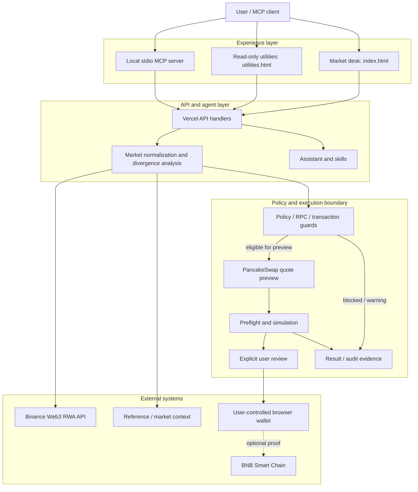

# PRONOUS Architecture

PRONOUS is organized as a small product system rather than a single-page demo.

## System shape



## Repository layers

| Area | Responsibility |
|---|---|
| `index.html`, `desk-*.js`, `desk-*.css` | Main market desk, charts, market state, wallet bridge, execution cockpit and responsive layout |
| `utilities.html` | Read-only portfolio watcher, local alerts and cross-venue utilities |
| `wallet-connect.js` | Browser wallet connection surface |
| `api/` | Vercel serverless entry points for market data, scans, portfolio, quote/preflight, POA and related requests |
| `lib/market.js`, `lib/rwa-parity.js`, `lib/candles.js` | Market normalization, parity/divergence and candle data |
| `lib/policy.js`, `lib/execution-gates.js`, `lib/tx-policy.js` | Deterministic policy and execution constraints |
| `lib/pancakeswap-quote.js` | Quote-preview integration; not a swap submitter |
| `lib/bsc-readonly.js`, `lib/rpc-guard.js` | Read-only chain access and RPC policy |
| `lib/execution.js`, `lib/execution-result.js`, `lib/wallet-state.js` | Guarded preparation, result handling and wallet state |
| `mcp/` | Local stdio MCP server and tool adapters |
| `agent/` | Agentic Wallet / Agent Studio guidance, schemas and identity records |
| `pronous/` | BNB Agent Studio seller workspace |
| `contracts/` | `PoaAnchor.sol` and contract verification material |
| `scripts/` | Tests, audits, production probes, measurements and identity verification |
| `docs/` | Architecture, product, security, integration, demo and submission evidence |
| `.github/workflows/` | Repository CI, audit, production probe and manual diagnostic workflows |
| `vercel.json` | Deployment routing/configuration |

This map describes the current repository; it is not a proposal to move files. Root-level API handlers and static assets remain where the current deployment expects them.
## Request flow

```
Market data
   ↓
Normalize asset
   ↓
Compare token/reference price
   ↓
Detect gap
   ↓
Check market state
   ↓
Apply policy
   ↓
Build plan
   ↓
Preflight / simulation
   ↓
User confirmation
   ↓
Execution
   ↓
Record result
```

## Repository layers

- **UI** — `index.html`: product dashboard, market terminal, asset drawer and execution cockpit.
- **Agent** — `api/agent.js`: market intelligence, plans, preflight and execution adapters.
- **Skills** — `api/skills.js`: specialized agent capabilities and routing.
- **Assistant** — `api/ask.js`: lightweight deterministic PRONOUS assistant.
- **Agent docs** — `agent/`: Agentic Wallet, Agent Studio and task definitions.
- **Documentation** — `docs/`: architecture, product and developer notes.

## Safety boundary

The agent can observe and prepare an action without automatically spending funds.

```
READ → ANALYZE → GUARD → PREPARE → SIMULATE → CONFIRM → EXECUTE
```

Wallet confirmation and configured policy remain the boundary for consequential actions.
